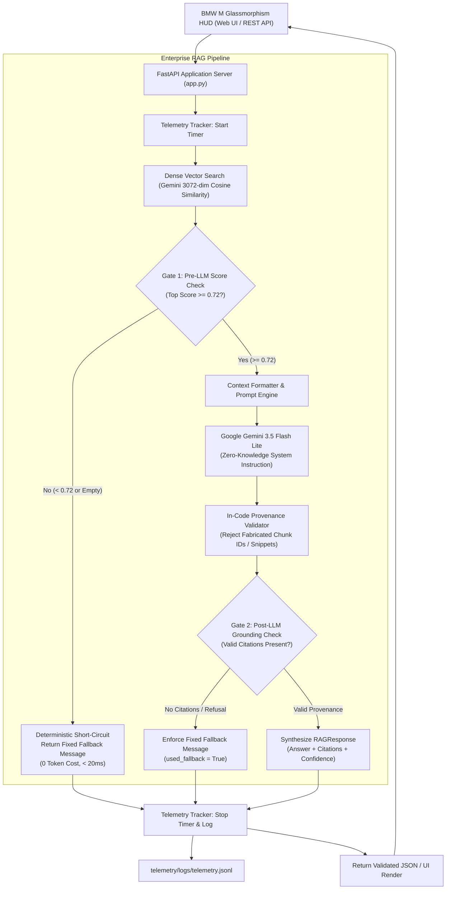

# BMW M Production-Grade RAG System (v2)

[](https://github.com/Debanshu17/bmw-ai-chatbot-v2/actions)


An enterprise-grade, high-performance Retrieval-Augmented Generation (RAG) system engineered for technical automotive specifications. Built on a curated 32-chunk technical knowledge base across 3 BMW M engineering guides, the system features deterministic multi-stage guardrails, in-code citation provenance verification, real-time latency and financial telemetry, and an automated evaluation harness.

> **Note on Repositories**: The original chatbot codebase is preserved 100% untouched and intact in its own standalone repository at [`https://github.com/Debanshu17/bmw-ai-chatbot`](https://github.com/Debanshu17/bmw-ai-chatbot). This repository (`bmw-ai-chatbot-v2`) represents the completely re-architected production system.

### 📚 Knowledge Base Specifications
The vector index indexes exactly **32 curated technical documentation chunks** across 3 engineering reference guides in [`data/raw_documents/`](data/raw_documents/):
1. **`bmw_m_s58_engine_technical_guide.md` (12 chunks)**: Covers crankcase architecture, closed-deck block, forged crankshaft, indirect liquid-to-air charge air cooling, dual-mono-scroll turbocharging, 350-bar high-pressure direct injection, variable valve timing (Double-VANOS / Valvetronic), and map-controlled oil supply.
2. **`bmw_m_chassis_xdrive_dynamics.md` (12 chunks)**: Covers M xDrive all-wheel-drive multi-plate clutch transfer case (4WD, 4WD Sport, 2WD), Active M Differential electronic multi-plate lock, Adaptive M Suspension dual-valve dampers, and M Compound / Carbon Ceramic braking dynamics.
3. **`bmw_m_aerodynamics_and_lightweight_engineering.md` (8 chunks)**: Covers Carbon Fiber Reinforced Plastic (CFRP) structural roof construction, active cooling air flap control, rear diffuser downforce channels, and lightweight M Race Track package weight reduction metrics.

---

## 🏛️ System Architecture



---

## 📊 Benchmark Comparison: Closed-Book Baseline vs. v2 Production

Evaluated on the 40-question technical benchmark ([`evals/dataset.jsonl`](evals/dataset.jsonl)) using **Google Gemini 3.5 Flash Lite** (`gemini-3.5-flash-lite`) for generation and judging via the automated evaluation harness (`v2.1.0`).

- **Closed-book baseline report**: [`reports/eval_v1_baseline_20261031_010339.json`](reports/eval_v1_baseline_20261031_010339.json)
- **v2 Production RAG (Initial Run, Before Citation Fix)**: [`reports/eval_v2_production_20261031_011115.json`](reports/eval_v2_production_20261031_011115.json)
- **v2 Production RAG (Final Run, After Citation Fix)**: [`reports/eval_v2_production_20261031_133931.json`](reports/eval_v2_production_20261031_133931.json)
- **Dedicated baseline latency report (pacing excluded)**: [`reports/eval_v1_latency_bench_20261031.json`](reports/eval_v1_latency_bench_20261031.json)

| Evaluation Metric | Closed-Book Baseline<br>*(Plain Gemini, No Docs)* | v2 Initial Run<br>*(Before Citation Fix)* | v2 Final Run<br>*(After Citation Fix)* | Benchmark Target | Metric Focus |
| :--- | :---: | :---: | :---: | :---: | :--- |
| **Run Validity** | **VALID** | **VALID** | **VALID** | Valid (Errors $\le 5\%$) | Infrastructure stability |
| **Infrastructure Errors** | 0 (0.0%) | 0 (0.0%) | 0 (0.0%) | 0 errors | 429 quota / network resilience |
| **Overall Accuracy (All 40 Qs)** | **45.0%** (18/40) | **95.0%** (38/40) | **100.0%** (40/40) | $\ge 85.0\%$ | Macro system correctness |
| **— Answerable Accuracy (30 Qs)** | **53.3%** (16/30) | **93.3%** (28/30) | **100.0%** (30/30) | $\ge 85.0\%$ | Factual grounding & recall |
| **— Out-of-Scope Accuracy (10 Qs)** | **20.0%** (2/10) | **100.0%** (10/10) | **100.0%** (10/10) | $\ge 90.0\%$ | Hallucination prevention |
| **Citation Precision** | 100.0% | 100.0% | **100.0%** | $\ge 90.0\%$ | Provenance authenticity |
| **Citation Recall** | 25.0% | 96.25% | **98.75%** | $\ge 80.0\%$ | Grounded source coverage |
| **Fallback True-Positive Rate (TPR)** | 0.0% (0/10) | 100.0% (10/10) | **100.0%** (10/10) | $\ge 90.0\%$ | Out-of-scope refusal compliance |
| **False-Fallback Rate (FFR)** | 0.0% (0/30) | 3.33% (1/30) | **0.0%** (0/30) | $\le 10.0\%$ | Avoid refusing valid questions |
| **Compute Latency (Answerable Only)** | | | | | *(Pacing excluded from baseline & final v2)* |
| **— Average Latency (Answerable Only)** | 5,453.9 ms | *[Not comparable]*\* | **7,355.5 ms** | Operational tracking | Pure compute duration |
| **— Median (p50) Latency (Answerable Only)** | 3,999.2 ms | *[Not comparable]*\* | **8,190.8 ms** | Operational tracking | Median execution time |
| **— p95 Latency (Answerable Only)** | 13,606.1 ms | *[Not comparable]*\* | **15,208.2 ms** | Operational tracking | 95th percentile tail |
| **Average Cost / Query (Overall)** | \$0.000668 | \$0.000628 | **\$0.000627** | $< \$0.005$ | Theoretical projection |
| **— Average Cost / Query (Answerable Only)** | \$0.000668 | \$0.000837 | **\$0.000836** | $< \$0.005$ | Context-loaded queries |
| **Answer Source: Genuine Gemini Generation** | 40 / 40 (100%) | 40 / 40 (100%) | **40 / 40 (100%)** | 100% on answerable | Zero extractive fallback used |
| **Judge Method: LLM-as-a-Judge** | 40 / 40 (100%) | 30 / 30 on answerable | **30 / 30 on answerable** | Strict rubric | 100% LLM on answerable (10/10 fuzzy on OOS) |

*\*Note on v2 Initial Run Latency: v2 Initial Run latency cells are marked not comparable because they were measured with the rate-limiter pause inside the timer (since fixed in the final run where pacing sleep is enforced strictly outside the timed region).*

### 🐛 Bug Found by the Evaluation Harness: Citation Key Resolution
During diagnostic inspection of the initial benchmark run ([`reports/eval_v2_production_20261031_011115.json`](reports/eval_v2_production_20261031_011115.json)), the automated evaluation harness uncovered a false refusal on query `eval_003` (*"How is the intake air cooled in the S58 forced induction system?"*), causing a 3.33% False-Fallback Rate (28/30 answerable accuracy).

- **Root Cause Uncovered by Logs**: Retrieval had succeeded (top similarity score was 0.7566 > 0.72) and Gemini generated an accurate answer and quote, but cited `"chunk_id": "fd73eb6cf193_1"` instead of the composite key `"bmw_m_s58_engine_technical_guide.md#fd73eb6cf193_1"`. Because `validate_and_filter_citations()` performed strict dictionary key lookup, the citation was stripped as unrecognized (`valid_citations = []`), triggering Gate 2 to enforce fallback due to zero verified citations.
- **The Architectural Fix**: Updated `validate_and_filter_citations()` in [`generation/validator.py`](generation/validator.py) to resolve both composite keys (`"file.md#id"`) and bare ID suffixes (`"id"`), resolving a bare ID to the single matching retrieved chunk and rejecting ambiguous or fabricated IDs. Added 5 unit tests in [`tests/test_citations.py`](tests/test_citations.py).
- **Post-Fix Benchmark Result**: Re-evaluating the v2 pipeline across all 40 queries ([`reports/eval_v2_production_20261031_133931.json`](reports/eval_v2_production_20261031_133931.json)) resolved the false fallback (FFR dropped from 3.33% to **0.0%**), elevating overall accuracy from 95.0% (38/40) to **100.0% (40/40)** and answerable accuracy from 93.3% (28/30) to **100.0% (30/30)** with citation recall increasing to **98.75%**.

> **Latency & Computational Tradeoff Analysis**:
> - **v2 Is Slower on Answerable Queries**: Across answerable queries, v2 is computationally heavier and slower than the closed-book baseline (median latency 8,190.8 ms vs. 3,999.2 ms; average latency 7,355.5 ms vs. 5,453.9 ms). This latency increase is expected and directly caused by:
>   1. **Dense Vector Embedding**: Generating a 3072-dimensional vector embedding for the query via `gemini-embedding-001`.
>   2. **Vector Similarity Retrieval**: Computing cosine similarity scores across candidate chunks and sorting top-k results.
>   3. **Expanded Context Payload**: Injecting ~850 prompt tokens of retrieved technical documentation (compared to ~25 prompt tokens for the unaugmented baseline).
>   4. **Structured Generation & Provenance Verification**: Synthesizing structured JSON with citations and executing in-code substring provenance checks (`validate_and_filter_citations`) and Gate 2 guardrail checks before returning the response.
>   - *The Core Engineering Tradeoff*: v2 intentionally trades execution latency for factual correctness (100.0% vs. 53.3% accuracy on answerable questions), high citation recall (98.75% vs. 25.0%), and zero hallucinations.
> - **Out-of-Scope Queries**: For queries outside the documentation scope, Gate 1 short-circuits the pipeline before the LLM, returning in < 20 ms at $0 token cost.

---

## ⚠️ Limitations

1. **Benchmark Sample Size & Single-Run Scope (Small Dataset)**:
   The evaluation suite is limited to a curated 40-question single-run benchmark (30 answerable, 10 out-of-scope) evaluated at temperature=0.0. A 40-question benchmark is inherently small: single-item flips produce a 2.5% delta overall (and 3.33% on answerable questions). While effective for rapid regression catching, larger evaluation suites (e.g., 200+ multi-turn questions) evaluated across multiple runs with confidence intervals are required for comprehensive statistical power.

2. **Benchmark Circularity & In-Sample Bug Discovery**:
   The citation ID mismatch bug (`eval_003`) was discovered, diagnosed, and validated using this exact same 40-question benchmark. While the implemented fix is architecturally generalized (resolving any valid bare ID suffix to its unique retrieved chunk while rejecting ambiguous or fabricated IDs with strict unit test coverage), modifying logic in response to benchmark failures introduces potential circular validation / in-sample overfitting bias. Evaluating the pipeline on a separate, held-out test suite is essential for unbiased validation.

3. **Run-to-Run Variance on Model Generation (`eval_028`)**:
   Between the initial run (95.0% accuracy, 28/30 answerable) and the post-fix run (100.0% accuracy, 30/30 answerable), `eval_028` (M xDrive torque dynamics) shifted from FAIL to PASS. This change was **not caused by the citation validator fix**, but is the result of natural run-to-run variance in LLM generation phrasing (the model generated a slightly more complete explanation of continuous multi-plate clutch transfer case dynamics that met the judge rubric).

4. **Cross-Run Latency Comparability & Network Variance**:
   Latency was measured on different days and under varying network conditions across runs (including a documented external network incident where API socket connections dropped during queries 5 and 6). Consequently, the v2-vs-baseline latency comparison is **indicative only**, reflecting real-world API endpoint variability rather than a strictly controlled synchronous laboratory benchmark.

5. **Shared LLM-as-a-Judge Architecture (Potential Bias)**:
   The evaluation harness uses `gemini-3.5-flash-lite` both for response generation and as the judge model in `evals/judge.py`. While the judge operates under a rigid, zero-temperature factual rubric outputting structured JSON, using the same model family for grading creates potential self-preference bias or shared blind spots. Future iterations will incorporate cross-provider judges (e.g., Claude 3.5 Sonnet or GPT-4o) to ensure independent verification.

6. **Projected Financial Pricing vs. Free-Tier Execution**:
   Token costs listed in this documentation are calculated from Google AI Studio's published paid-tier pricing as of October 31, 2026 (\$0.30 / 1M input tokens, \$2.50 / 1M output tokens). Development, testing, and automated benchmarking were executed exclusively within Google's Free Tier with rate-limiting backoff, resulting in **\$0.00 of actual financial spend**.

### Graceful-Degradation Extractive Fallback Mode
The system features an automated **extractive fallback mode** as an emergency safety net: if LLM JSON parsing or network streaming fails, the system safely extracts the top grounded chunk sentence with verified source provenance so the user receives a grounded excerpt rather than an unhandled error.

**Benchmark Grounding Rule**: Under rigorous evaluation standards, extractive fallback is treated as a separate recovery mode and is strictly **excluded from accuracy**. If extractive fallback exceeds 5.0% of answerable questions in a benchmark run, the run is flagged as `INVALID`. In the final validated evaluation run, **0 out of 30 answerable queries used extractive fallback (100% genuine Gemini generation)**, guaranteeing authentic model performance.

---

## 🧱 The 4 Pillars of Implementation

### Pillar 1: Evaluation Harness (`evals/`)
- **40-Query Benchmark Dataset (`evals/dataset.jsonl`)**: 30 answerable technical queries (numeric specs, factual, multi-chunk synthesis) and 10 out-of-scope adversarial questions. Every ground truth fact is verified against source documents.
- **Infrastructure Error Resilience (`evals/retry.py`)**: Automatic exponential backoff retry (up to 5 attempts) on transient API failures (HTTP 429 quota exhaustion, timeouts, 503). If an infrastructure failure persists, the result is tagged as `ERROR` and strictly excluded from accuracy and latency percentiles. If infrastructure errors exceed 5% of queries, the run immediately aborts.
- **Checkpointing & Resume (`--resume`)**: The evaluation runner checkpoints results to disk after every single query. Running with `--resume` reuses successful cached queries and only retries missing or `ERROR` questions.
- **Answer Source & Judge Auditing**: Explicitly records whether each response originated from `"gemini"` (LLM generation) or `"extractive_fallback"`, and whether each judgment used `"llm"` (LLM-as-a-judge zero-temperature rubric) or `"fuzzy"` (deterministic refusal match).
- **CLI Runner (`evals/run_evals.py`)**: Computes valid accuracy, citation precision/recall, fallback reliability (TPR/FFR), latency percentiles (p50, p95), answer source breakdowns, judge breakdowns, and token costs.

### Pillar 2: Strict Metadata & Source Citations (`retrieval/` & `generation/`)
- **Provenance Chunking**: Ingestion pipeline records `source_doc`, `page_or_chapter`, `chunk_id`, and character offsets (`start`, `end`) for every chunk.
- **Pydantic Validation (`generation/schemas.py`)**: Responses strictly enforce the `RAGResponse` schema:
  `{ answer, citations: [{doc, page_or_chapter, chunk_id, quote_snippet}], confidence, used_fallback }`.
- **In-Code Verification (`generation/validator.py`)**: Confirms every cited `chunk_id` was in the retrieved set and verifies that `quote_snippet` exists as an authentic substring. Fabricated citations are stripped.
- **Interactive UI Citations**: The frontend renders interactive motorsport pills under each response that expand to reveal the document name, chapter, and verbatim quote snippet.

### Pillar 3: Cost & Latency Telemetry (`telemetry/`)
- **Execution Tracking (`telemetry/monitor.py`)**: Tracks total compute latency, prompt tokens, and completion tokens per query.
- **Config-Driven Cost Calculator (`config/pricing.json`)**: Derives query costs dynamically from model pricing rates without hardcoded constants.
- **Metrics Endpoint (`/metrics`)**: Exposes rolling window operational metrics including average latency, p50, p95, total costs, and fallback rates.

### Pillar 4: Deterministic Fallback Guardrails (`guardrails/`)
- **Dual-Stage Gating**:
  - **Gate 1 (Pre-LLM)**: Intercepts queries where top retrieval similarity is below `0.72` or empty, returning the canonical refusal message without invoking the LLM (0 token cost, < 20ms).
  - **Gate 2 (Post-LLM)**: Detects missing citations or refusal indicators, enforcing the fixed fallback message.
- **Fixed Constant**:
  `"I couldn't find this in the provided documents, so I can't answer it reliably."`
- **Zero-Leakage System Prompt**: Strictly forbids using outside training knowledge.

---

## 🚀 Quickstart & Setup Guide

### 1. Prerequisites
- Python 3.11+
- Google Gemini API Key

### 2. Installation
```bash
# Clone or navigate to the v2 repository
cd bmw-ai-chatbot-v2

# Install pinned dependencies
pip install -r requirements.txt

# Configure environment variables
cp .env.example .env
# Edit .env with your GEMINI_API_KEY
```

### 3. Build Vector Store Index
```bash
python -c "from retrieval.index import global_vector_index; global_vector_index.build()"
```

### 4. Run the Application
```bash
# Start FastAPI backend server
python app.py
```
Visit **[http://127.0.0.1:8000](http://127.0.0.1:8000)** to interact with the BMW M glassmorphism interface!

---

## 🧪 Testing & Reproducibility

### 1. Run Unit Tests
```bash
python -m pytest tests/ -v
```

### 2. Reproduce the Evaluation Benchmark
The repository provides [`evals/run_both.py`](evals/run_both.py) to execute the complete benchmark sequentially with pre-flight model validation, rate limiting (8 requests/minute), and persistent disk checkpointing:

1. **Pre-flight Check**: Pings `gemini-3.5-flash-lite` to verify API key validity and active quota before starting.
2. **Step 1 (Closed-Book Baseline)**: Evaluates the zero-RAG parametric Gemini model across all 40 questions in `evals/dataset.jsonl`.
3. **Step 2 (v2 Production RAG)**: Evaluates the full production RAG pipeline (retrieval + dual-stage gating) on the same 40 questions.
4. **Resilience**: Automatically applies stop-and-wait retries on HTTP 429 rate limits, ignoring legacy archived caches, and outputs structured JSON and Markdown reports.

```bash
# Run both baseline and v2 in a single paced pass
python evals/run_both.py

# Or run pipelines individually:
python evals/run_evals.py --baseline-v1 --dataset evals/dataset.jsonl --out reports/
python evals/run_evals.py --dataset evals/dataset.jsonl --out reports/

# Resume an interrupted run (skips successful queries, retries missing/errors):
python evals/run_evals.py --dataset evals/dataset.jsonl --out reports/ --resume

# Compare baseline and v2 evaluation reports:
python evals/run_evals.py --diff reports/eval_v1_baseline_20261031_010339.json reports/eval_v2_production_20261031_011115.json
```

---

## 📦 Repository Organization

- **Original Baseline Repository**: [`https://github.com/Debanshu17/bmw-ai-chatbot`](https://github.com/Debanshu17/bmw-ai-chatbot) (Preserved untouched).
- **v2 Production RAG Repository**: [`https://github.com/Debanshu17/bmw-ai-chatbot-v2`](https://github.com/Debanshu17/bmw-ai-chatbot-v2) (Production system).
