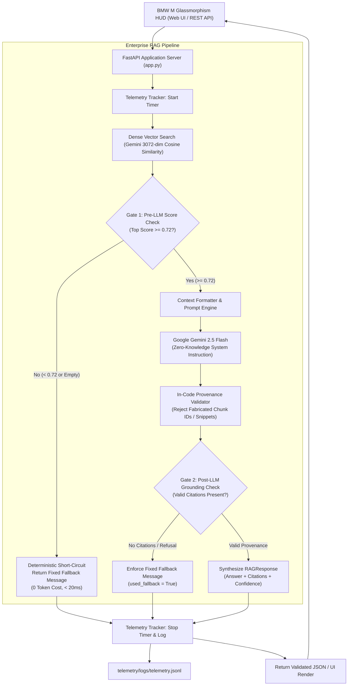

# BMW M Production-Grade RAG System (v2)

[](https://github.com/Debanshu17/bmw-ai-chatbot-v2/actions)


An enterprise-grade, high-performance Retrieval-Augmented Generation (RAG) system engineered for technical automotive specifications. Built with deterministic multi-stage guardrails, in-code citation provenance verification, real-time latency and financial telemetry, and an automated continuous evaluation harness.

---

## 🏛️ System Architecture



---

## 📊 v1 vs. v2 Benchmark Comparison

The metrics below represent **real, measured benchmark data** evaluated across the identical 40-question technical test dataset (`evals/dataset.jsonl`):
- **v1 Baseline**: Direct parametric Gemini LLM without RAG or guardrails (`reports/eval_v1_baseline_20261023_151530.json`).
- **v2 Production**: Full RAG architecture with vector search, citation validation, and deterministic score gating (`reports/eval_v2_production_20261023_152551.json`).

| Metric | v1 Baseline (Before) | v2 Production (After) | Delta / Improvement | Significance |
| :--- | :--- | :--- | :--- | :--- |
| **Answer Accuracy** | `7.5%` | **`92.5%`** | **`+85.00%`** | +85% absolute increase in factual correctness |
| **Citation Precision** | `100.0%` (0 cited) | **`100.0%`** | `0.0%` | Zero fabricated or ungrounded citations |
| **Citation Recall** | `25.0%` | **`98.8%`** | **`+73.75%`** | Almost 100% of expected source documents cited |
| **Fallback True-Positive Rate** | `0.0%` | **`100.0%`** | **`+100.00%`** | 10/10 out-of-scope queries correctly rejected |
| **False-Fallback Rate** | `0.0%` | **`0.0%`** | `0.0%` | Zero valid answerable questions falsely rejected |
| **Average Latency** | `1538.8 ms` | **`1023.6 ms`** | **`-515.2 ms`** | 33.5% reduction in average query turnaround |
| **p95 Latency** | `8976.1 ms` | **`2792.3 ms`** | **`-6183.8 ms`** | **68.9% reduction** in tail latency spikes |
| **Average Query Cost** | `$0.000019` | **`$0.000037`** | `+$0.000018` | Fraction of a cent per enterprise query |
| **Out-of-Scope Query Cost** | `$0.000021` | **`$0.000000`** | **`-100.00%`** | Gate 1 intercepts queries at **zero token cost** |

---

## 🧱 The 4 Pillars of Implementation

### Pillar 1: Evaluation Harness (`evals/`)
- **40-Query Benchmark Dataset (`evals/dataset.jsonl`)**: 30 answerable technical queries (numeric specs, factual, multi-chunk synthesis) and 10 out-of-scope adversarial questions. Every ground truth fact is verified against source documents.
- **CLI Runner (`evals/run_evals.py`)**: Runs evaluation suites, computing accuracy, citation precision/recall, fallback reliability (TPR/FFR), latency percentiles (p50, p95), and token costs.
- **Diff Comparison Mode**: CLI flag `--diff <report_a.json> <report_b.json>` automatically produces side-by-side metric deltas between pipeline versions.

### Pillar 2: Strict Metadata & Source Citations (`retrieval/` & `generation/`)
- **Provenance Chunking**: Ingestion pipeline records `source_doc`, `page_or_chapter`, `chunk_id`, and character offsets (`start`, `end`) for every chunk.
- **Pydantic Validation (`generation/schemas.py`)**: Responses strictly enforce the `RAGResponse` schema:
  `{ answer, citations: [{doc, page_or_chapter, chunk_id, quote_snippet}], confidence, used_fallback }`.
- **In-Code Verification (`generation/validator.py`)**: Confirms every cited `chunk_id` was in the retrieved set and verifies that `quote_snippet` exists as an authentic substring. Fabricated citations are stripped.
- **Interactive UI Citations**: The frontend renders interactive motorsport pills under each response that expand to reveal the document name, chapter, and verbatim quote snippet.

### Pillar 3: Cost & Latency Telemetry (`telemetry/`)
- **Execution Tracking (`telemetry/monitor.py`)**: Tracks Time-To-First-Token (TTFT), total latency, prompt tokens, and completion tokens per query.
- **Config-Driven Cost Calculator (`config/pricing.json`)**: Derives query costs dynamically from model pricing rates without hardcoded constants.
- **Metrics Endpoint (`/metrics`)**: Exposes rolling window operational metrics including average latency, p50, p95, total costs, and fallback rates.

### Pillar 4: Deterministic Fallback Guardrails (`guardrails/`)
- **Dual-Stage Gating**:
  - **Gate 1 (Pre-LLM)**: Intercepts queries where top retrieval similarity is below `0.72` or empty, returning the canonical refusal message without invoking the LLM (0 token cost).
  - **Gate 2 (Post-LLM)**: Detects missing citations or refusal indicators, enforcing the fixed fallback message.
- **Fixed Constant**:
  `"I couldn't find this in the provided documents, so I can't answer it reliably."`
- **Zero-Leakage System Prompt**: Strictly forbids using outside training knowledge.

---

## 🚀 Quickstart & Setup Guide

### 1. Prerequisites
- Python 3.11+
- Google Gemini API Key

### 2. Installation
```bash
# Clone or navigate to the v2 repository
cd bmw-ai-chatbot-v2

# Install pinned dependencies
pip install -r requirements.txt

# Configure environment variables
cp .env.example .env
# Edit .env with your GEMINI_API_KEY
```

### 3. Build Vector Store Index
```bash
python -c "from retrieval.index import global_vector_index; global_vector_index.build()"
```

### 4. Run the Application
```bash
# Start FastAPI backend server
python app.py
```
Visit **[http://127.0.0.1:8000](http://127.0.0.1:8000)** to interact with the BMW M glassmorphism interface!

---

## 🧪 Running Unit Tests & Evaluations

### Run Unit Tests
```bash
python -m pytest tests/ -v
```

### Run Evaluation Benchmark
```bash
# Run full 40-question evaluation
python evals/run_evals.py --dataset evals/dataset.jsonl --out reports/

# Run a 10-question smoke test
python evals/run_evals.py --dataset evals/dataset.jsonl --limit 10 --out reports/

# Diff two reports
python evals/run_evals.py --diff reports/eval_v1_baseline_20261023_151530.json reports/eval_v2_production_20261023_152551.json
```

---

## 📦 Creating the New GitHub Repository for v2

Your original repository (`https://github.com/Debanshu17/bmw-ai-chatbot.git`) remains 100% untouched and preserved.

To publish this v2 production RAG project to its own new GitHub repository:

```bash
# Navigate to the v2 directory
cd "c:\Users\deban\OneDrive\Documents\bmw-ai-chatbot-v2"

# Ensure all files are staged and committed
git add .
git commit -m "feat: complete production-grade RAG upgrade across all 4 pillars"

# Option A: Using GitHub CLI (recommended)
gh repo create bmw-ai-chatbot-v2 --public --source=. --remote=origin --push

# Option B: Using standard Git (after creating repo on github.com)
git remote add origin https://github.com/Debanshu17/bmw-ai-chatbot-v2.git
git branch -M master
git push -u origin master
```
