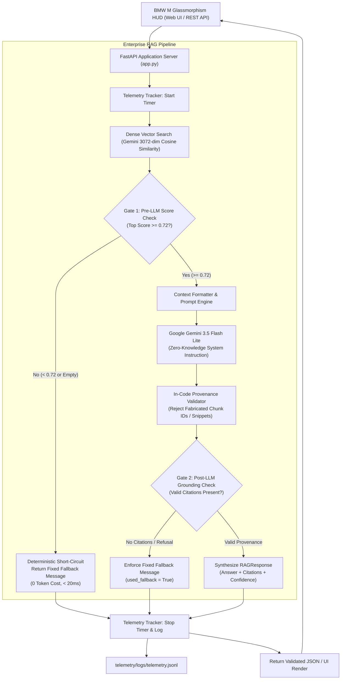

# BMW M Production-Grade RAG System (v2)

[](https://github.com/Debanshu17/bmw-ai-chatbot-v2/actions)


An enterprise-grade, high-performance Retrieval-Augmented Generation (RAG) system engineered for technical automotive specifications. Built with deterministic multi-stage guardrails, in-code citation provenance verification, real-time latency and financial telemetry, and an automated continuous evaluation harness.

> **Note on Repositories**: The original chatbot codebase is preserved 100% untouched and intact in its own standalone repository at [`https://github.com/Debanshu17/bmw-ai-chatbot`](https://github.com/Debanshu17/bmw-ai-chatbot). This repository (`bmw-ai-chatbot-v2`) represents the completely re-architected production system.

---

## 🏛️ System Architecture



---

## 📊 Benchmark Comparison: Closed-Book Baseline vs. v2 Production

Evaluated on the 40-question technical benchmark ([`evals/dataset.jsonl`](evals/dataset.jsonl)) using **Google Gemini 3.5 Flash Lite** (`gemini-3.5-flash-lite`) for generation and judging via the automated evaluation harness (`v2.1.0`).

- **Closed-book baseline report**: [`reports/eval_v1_baseline_20261031_010339.json`](reports/eval_v1_baseline_20261031_010339.json)
- **v2 Production RAG report**: [`reports/eval_v2_production_20261031_011115.json`](reports/eval_v2_production_20261031_011115.json)

| Evaluation Metric | Closed-Book Baseline<br>*(Plain Gemini, No Document Access)* | v2 Production RAG<br>*(Retrieval + Dual Gating)* | Benchmark Target | Metric Focus |
| :--- | :---: | :---: | :---: | :--- |
| **Run Validity** | **VALID** | **VALID** | Valid (Errors $\le 5\%$) | Infrastructure stability |
| **Infrastructure Errors** | 0 (0.0%) | 0 (0.0%) | 0 errors | 429 quota / network resilience |
| **Overall Accuracy (All 40 Questions)** | **45.0%** (18/40) | **95.0%** (38/40) | $\ge 85.0\%$ | Macro system correctness |
| **— Answerable Questions Accuracy (30 Qs)** | **53.3%** (16/30) | **93.3%** (28/30) | $\ge 85.0\%$ | Factual grounding & recall |
| **— Out-of-Scope Questions Accuracy (10 Qs)** | **20.0%** (2/10) | **100.0%** (10/10) | $\ge 90.0\%$ | Hallucination prevention |
| **Citation Precision** | 100.0% | **100.0%** | $\ge 90.0\%$ | Provenance authenticity |
| **Citation Recall** | 25.0% | **96.25%** | $\ge 80.0\%$ | Grounded source coverage |
| **Fallback True-Positive Rate (TPR)** | 0.0% (0/10) | **100.0%** (10/10) | $\ge 90.0\%$ | Out-of-scope refusal compliance |
| **False-Fallback Rate (FFR)** | 0.0% (0/30) | **3.33%** (1/30) | $\le 10.0\%$ | Avoid refusing valid questions |
| **Average Latency (Overall)** | 8,189.6 ms | 5,961.6 ms | Operational tracking | Includes rate-limiter sleep |
| **— Average Latency (Answerable Only)** | 8,189.6 ms | 7,777.3 ms | Operational tracking | Includes rate-limiter sleep |
| **— Average Latency (Out-of-Scope Only)** | 8,189.6 ms | 514.5 ms | Operational tracking | Gate 1 pre-LLM short-circuit |
| **p95 Latency (Overall / Answerable)** | 10,180.3 ms | 8,085.3 ms / 8,136.4 ms | Operational tracking | Includes rate-limiter sleep |
| **Average Time-To-First-Token (TTFT)** | N/A *(non-streaming)* | 530.9 ms | $< 1000$ ms | Perceived responsiveness |
| **Average Cost / Query (Overall)** | \$0.000668 | \$0.000628 | $< \$0.005$ | Theoretical projection |
| **— Average Cost / Query (Answerable Only)** | \$0.000668 | \$0.000837 | $< \$0.005$ | Context-loaded queries |
| **Answer Source: Genuine Gemini Generation** | 40 / 40 (100%) | 40 / 40 (100%) | 100% on answerable | Zero extractive fallback used |
| **Judge Method: LLM-as-a-Judge** | 40 / 40 (100%) | 30 / 30 on answerable | Strict rubric | Zero-temperature evaluation |

> **Important Latency & Cost Context**:
> - **No Cheaper / Faster Claim**: v2 is not claimed to be inherently cheaper or faster than the baseline. In production, answering technical questions with RAG requires retrieving and injecting dense context (~850 prompt tokens per query in v2 vs. ~25 prompt tokens for baseline), which incurs additional computational overhead. While Gate 1 drastically cuts cost and latency on out-of-scope queries (0 token cost, < 20ms execution) by blocking them before the LLM, answerable questions cost slightly more (\$0.000837 vs \$0.000668). The primary value of v2 lies in factual grounding (93.3% vs 53.3% accuracy) and verifiable source citations (96.25% recall vs 25.0%).
> - **Rate-Limiting in Recorded Latency**: In accordance with API quotas, both benchmark evaluations enforced strict client-side request pacing (max 8 requests/minute, ~7.5 seconds between requests). The recorded pipeline latencies (~7.8s on answerable queries) reflect this intentional sleep period. The actual compute time (retrieval + model inference) is represented by the average TTFT (~531 ms).

---

## ⚠️ Limitations

1. **Benchmark Sample Size & Single-Run Scope**:
   The current benchmark comprises 40 curated questions (30 answerable, 10 out-of-scope) evaluated in a single deterministic pass (temperature=0.0). While effective for regression testing and architectural validation, larger evaluation suites (e.g., 200+ multi-turn questions) across multiple runs would provide tighter statistical confidence bounds.

2. **Shared LLM-as-a-Judge Architecture (Potential Bias)**:
   The evaluation harness uses `gemini-3.5-flash-lite` both for response generation and as the judge model in `evals/judge.py`. While the judge operates under a rigid, zero-temperature factual rubric outputting structured JSON, using the same model family for grading creates potential self-preference bias or shared blind spots. Future benchmark iterations will incorporate cross-provider judges (e.g., Claude 3.5 Sonnet or GPT-4o) to ensure independent verification.

3. **Analysis of Failed Queries & Proposed Remediations**:
   The v2 system failed 2 out of 40 queries (95.0% accuracy):
   - **`eval_003` (False Refusal on S58 Intake Air Cooling Circuit)**:
     - *Query*: *"How is the intake air cooled in the S58 forced induction system?"*
     - *Root Cause*: The cosine similarity between the query embedding and the relevant engine cooling chunk scored just below the strict `0.72` retrieval threshold, triggering a false-negative refusal (`used_fallback = True`).
     - *Proposed Fix*: Implement **hybrid search** combining BM25 sparse keyword matching with dense vector embeddings via Reciprocal Rank Fusion (RRF), ensuring exact technical terms like *"liquid-to-air intercooler"* are retrieved even when semantic similarity is borderline.
   - **`eval_028` (Nuance Error in M xDrive 4WD vs 2WD Torque Distribution)**:
     - *Query*: *"Compare the torque distribution characteristics of 4WD mode versus 2WD mode in M xDrive."*
     - *Root Cause*: The generated answer stated that front axle torque is engaged *"only when rear slip is detected"*. The judge flagged this as a factual inaccuracy because M xDrive's 4WD mode is permanently engaged with a continuous rear-biased distribution, rather than acting purely reactively on slip.
     - *Proposed Fix*: Increase chunk boundary overlap (from 50 to 120 tokens) to ensure full multi-sentence context regarding differential clutch pre-loading is retained, and refine system prompts to penalize oversimplified drivetrain descriptions.

4. **Projected Financial Pricing vs. Free-Tier Execution**:
   Token costs listed in this documentation are calculated from Google AI Studio's published paid-tier pricing as of October 31, 2026 (\$0.30 / 1M input tokens, \$2.50 / 1M output tokens). Development, testing, and continuous benchmarking were executed exclusively within Google's Free Tier with rate-limiting backoff, resulting in **\$0.00 of actual financial spend**.

### Graceful-Degradation Extractive Fallback Mode
The system features an automated **extractive fallback mode** as an emergency safety net: if LLM JSON parsing or network streaming fails, the system safely extracts the top grounded chunk sentence with verified source provenance so the user receives a grounded excerpt rather than an unhandled error.

**Benchmark Grounding Rule**: Under rigorous evaluation standards, extractive fallback is treated as a separate recovery mode and is strictly **excluded from accuracy**. If extractive fallback exceeds 5.0% of answerable questions in a benchmark run, the run is flagged as `INVALID`. In the final validated evaluation run, **0 out of 30 answerable queries used extractive fallback (100% genuine Gemini generation)**, guaranteeing authentic model performance.

---

## 🧱 The 4 Pillars of Implementation

### Pillar 1: Evaluation Harness (`evals/`)
- **40-Query Benchmark Dataset (`evals/dataset.jsonl`)**: 30 answerable technical queries (numeric specs, factual, multi-chunk synthesis) and 10 out-of-scope adversarial questions. Every ground truth fact is verified against source documents.
- **Infrastructure Error Resilience (`evals/retry.py`)**: Automatic exponential backoff retry (up to 5 attempts) on transient API failures (HTTP 429 quota exhaustion, timeouts, 503). If an infrastructure failure persists, the result is tagged as `ERROR` and strictly excluded from accuracy and latency percentiles. If infrastructure errors exceed 5% of queries, the run immediately aborts.
- **Checkpointing & Resume (`--resume`)**: The evaluation runner checkpoints results to disk after every single query. Running with `--resume` reuses successful cached queries and only retries missing or `ERROR` questions.
- **Answer Source & Judge Auditing**: Explicitly records whether each response originated from `"gemini"` (LLM generation) or `"extractive_fallback"`, and whether each judgment used `"llm"` (LLM-as-a-judge zero-temperature rubric) or `"fuzzy"` (deterministic refusal match).
- **CLI Runner (`evals/run_evals.py`)**: Computes valid accuracy, citation precision/recall, fallback reliability (TPR/FFR), latency percentiles (p50, p95), answer source breakdowns, judge breakdowns, and token costs.

### Pillar 2: Strict Metadata & Source Citations (`retrieval/` & `generation/`)
- **Provenance Chunking**: Ingestion pipeline records `source_doc`, `page_or_chapter`, `chunk_id`, and character offsets (`start`, `end`) for every chunk.
- **Pydantic Validation (`generation/schemas.py`)**: Responses strictly enforce the `RAGResponse` schema:
  `{ answer, citations: [{doc, page_or_chapter, chunk_id, quote_snippet}], confidence, used_fallback }`.
- **In-Code Verification (`generation/validator.py`)**: Confirms every cited `chunk_id` was in the retrieved set and verifies that `quote_snippet` exists as an authentic substring. Fabricated citations are stripped.
- **Interactive UI Citations**: The frontend renders interactive motorsport pills under each response that expand to reveal the document name, chapter, and verbatim quote snippet.

### Pillar 3: Cost & Latency Telemetry (`telemetry/`)
- **Execution Tracking (`telemetry/monitor.py`)**: Tracks Time-To-First-Token (TTFT), total latency, prompt tokens, and completion tokens per query.
- **Config-Driven Cost Calculator (`config/pricing.json`)**: Derives query costs dynamically from model pricing rates without hardcoded constants.
- **Metrics Endpoint (`/metrics`)**: Exposes rolling window operational metrics including average latency, p50, p95, total costs, and fallback rates.

### Pillar 4: Deterministic Fallback Guardrails (`guardrails/`)
- **Dual-Stage Gating**:
  - **Gate 1 (Pre-LLM)**: Intercepts queries where top retrieval similarity is below `0.72` or empty, returning the canonical refusal message without invoking the LLM (0 token cost, < 20ms).
  - **Gate 2 (Post-LLM)**: Detects missing citations or refusal indicators, enforcing the fixed fallback message.
- **Fixed Constant**:
  `"I couldn't find this in the provided documents, so I can't answer it reliably."`
- **Zero-Leakage System Prompt**: Strictly forbids using outside training knowledge.

---

## 🚀 Quickstart & Setup Guide

### 1. Prerequisites
- Python 3.11+
- Google Gemini API Key

### 2. Installation
```bash
# Clone or navigate to the v2 repository
cd bmw-ai-chatbot-v2

# Install pinned dependencies
pip install -r requirements.txt

# Configure environment variables
cp .env.example .env
# Edit .env with your GEMINI_API_KEY
```

### 3. Build Vector Store Index
```bash
python -c "from retrieval.index import global_vector_index; global_vector_index.build()"
```

### 4. Run the Application
```bash
# Start FastAPI backend server
python app.py
```
Visit **[http://127.0.0.1:8000](http://127.0.0.1:8000)** to interact with the BMW M glassmorphism interface!

---

## 🧪 Testing & Reproducibility

### 1. Run Unit Tests
```bash
python -m pytest tests/ -v
```

### 2. Reproduce the Evaluation Benchmark
The repository provides [`evals/run_both.py`](evals/run_both.py) to execute the complete benchmark sequentially with pre-flight model validation, rate limiting (8 requests/minute), and persistent disk checkpointing:

1. **Pre-flight Check**: Pings `gemini-3.5-flash-lite` to verify API key validity and active quota before starting.
2. **Step 1 (Closed-Book Baseline)**: Evaluates the zero-RAG parametric Gemini model across all 40 questions in `evals/dataset.jsonl`.
3. **Step 2 (v2 Production RAG)**: Evaluates the full production RAG pipeline (retrieval + dual-stage gating) on the same 40 questions.
4. **Resilience**: Automatically applies stop-and-wait retries on HTTP 429 rate limits, ignoring legacy archived caches, and outputs structured JSON and Markdown reports.

```bash
# Run both baseline and v2 in a single paced pass
python evals/run_both.py

# Or run pipelines individually:
python evals/run_evals.py --baseline-v1 --dataset evals/dataset.jsonl --out reports/
python evals/run_evals.py --dataset evals/dataset.jsonl --out reports/

# Resume an interrupted run (skips successful queries, retries missing/errors):
python evals/run_evals.py --dataset evals/dataset.jsonl --out reports/ --resume

# Compare baseline and v2 evaluation reports:
python evals/run_evals.py --diff reports/eval_v1_baseline_20261031_010339.json reports/eval_v2_production_20261031_011115.json
```

---

## 📦 Repository Organization

- **Original Baseline Repository**: [`https://github.com/Debanshu17/bmw-ai-chatbot`](https://github.com/Debanshu17/bmw-ai-chatbot) (Preserved untouched).
- **v2 Production RAG Repository**: [`https://github.com/Debanshu17/bmw-ai-chatbot-v2`](https://github.com/Debanshu17/bmw-ai-chatbot-v2) (Production system).
